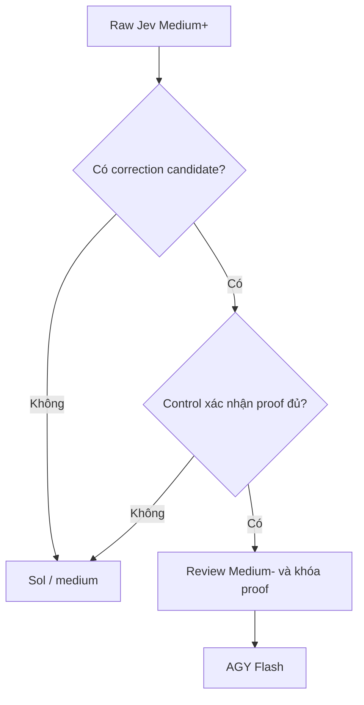

# Nghiên cứu và đặc tả hiệu chỉnh DELY + AGY

**Ngày đối chiếu:** 18/10/2026.  
**Phạm vi:** đánh giá bảng yêu cầu mới và xác định phần việc bổ sung cho agent dev.  
**Baseline source:** `D:\orca`, nhánh `master`, commit `1dcb4764a0fabc69a24ce5ec24e5cd40e13b477b`, working tree sạch tại thời điểm kiểm tra.  
**Trạng thái bàn giao:** tài liệu nghiên cứu; chưa sửa source, cài plugin, đổi settings, reset journal hoặc dispatch worker trong lượt này.

Đây là bản bổ sung theo hiện trạng mới. Source đã triển khai policy v4, nên không giao dev làm lại toàn bộ correction, basis hash hoặc ma trận route của đặc tả v4 trước đó. Các ký hiệu [SRC-1]–[SRC-9] và [WEB-1] dẫn tới nguồn ở cuối tài liệu.

## 1. Kết luận và thứ tự ưu tiên

Có thể giữ mục tiêu giảm những task Easy/Medium- bị đánh giá quá cao, đồng thời giữ nguyên độc quyền Medium+/Hard của Codex Sol. Tuy nhiên, bảng yêu cầu cần sửa ở ba điểm: đánh cờ theo hậu quả thay vì chỉ theo thao tác phá hủy; yêu cầu xem xét correction thay vì buộc hạ cấp; đo adoption theo đơn vị và mẫu số rõ ràng thay vì ép đạt tỷ lệ.

**Ưu tiên đầu tiên là đưa đúng bản v4 vào runtime được sử dụng.** Hai compliance settings đã kiểm tra vẫn trỏ tới router v3 trong plugin cache. Hàm `route()` của bản v3 đó còn khai báo Luna fallback cho Medium+, trong khi source v4 đã loại bỏ nhánh này. Đây là khác biệt cấu hình đã xác minh, không phải bằng chứng một phiên chạy đã thực sự dùng fallback sai. [SRC-1, SRC-5, SRC-6, SRC-7]

**Chưa thể kết luận quy mô “upward difficulty leakage”.** Journal hiện có 0 byte và 0 record. Không có mẫu để kiểm chứng tỷ lệ 8,3%, số task Hard bị gán nhầm, hoặc tỷ lệ sau thay đổi. Các số liệu lịch sử cần được dẫn từ bản dữ liệu lưu trữ tương ứng; chúng không thể được tái lập từ journal hiện tại. [SRC-8]

Ba gói việc được đề xuất:

1. **PRIO-0 — Runtime:** xác minh và triển khai bundle v4 theo quy trình cài đặt hiện có; kiểm tra cả hai Codex home và ma trận route thực sự được resolve.
2. **PRIO-1 — Yêu cầu và quan sát:** hiệu chỉnh task-creation/review instructions; thêm title/domain vào telemetry; báo cáo bằng cửa sổ thời gian, không reset log.
3. **PRIO-2 — Network fallback, nếu triển khai:** bổ sung như một thay đổi policy riêng, có điều kiện đối soát attempt; không giả định mọi lỗi mạng đã được fallback hỗ trợ.

## 2. Hiện trạng đã đối chiếu trực tiếp

| Hạng mục | Bằng chứng hiện tại | Ý nghĩa |
| --- | --- | --- |
| Router trong source | `jev-task-routing-v4`; 413 dòng; đã có candidate, proof validation và assessment basis | Correction không còn là tính năng chưa triển khai. [SRC-1] |
| Route trong source | Medium+ → Sol/medium, `fallback: []`; Hard → Sol/xhigh direct | Source đáp ứng độc quyền worker ở hai mức này. [SRC-1] |
| Hai compliance settings | Cùng trỏ tới router dưới `dely/0.27.2` trong plugin cache | Phải kiểm tra artifact cài đặt, không suy runtime từ HEAD. [SRC-5, SRC-6] |
| Router được settings resolve | `jev-task-routing-v3`; 236 dòng; Medium+ vẫn có `modelUnavailable: luna` và `fallback: [luna]` | Hợp đồng route của bản cài đặt chưa đáp ứng yêu cầu độc quyền Sol cho Medium+. [SRC-7] |
| Correction của v4 | Router tự tính candidate từ câu trả lời Jev; review giữ Medium+ không cần proof correction | Không sửa thành “có candidate là bắt buộc hạ cấp”. [SRC-1, SRC-2] |
| Telemetry v4 | Đã có basis, Jev difficulty, known-hard flags, decision source và các field correction | Chỉ bổ sung phần metadata/báo cáo còn thiếu. [SRC-3] |
| Title/domain | Chưa có trong `usage.js` | Đây là delta code nhỏ, có thể làm độc lập nếu không đổi gate. [SRC-3] |
| Review/dispatch | AGY implement-only; event `dispatch` được ghi sau receipt confirmed; có `outcome_unknown` | Đếm dispatch thực, giữ Control sở hữu review. [SRC-4] |
| Journal | `C:\Users\Home33\.dely\log.jsonl`: 0 byte, 0 record | Adoption hiện tại là N/A; không phải 0%. [SRC-8] |

Giới hạn của kết luận runtime: đã kiểm tra hai settings và file mà chúng trỏ tới. Chưa kiểm tra mọi process, phiên đang sống hoặc entry point khác. Việc source định nghĩa model không phải phép kiểm tra khả dụng của model tại provider.

### Dấu vân tay phục vụ bàn giao

- Source router SHA-256: `9e199c6064f52a3469cccb3eec1b8e68f70c3717e31f6aef504ba1920e1dcb8f`.
- Router trong plugin cache SHA-256: `eb12f46e5b9c574c303965c9cc6ee1c2cceecce685e1a2b470b00b71e6771676`.
- Hai settings lưu dependency hash tương ứng với bản plugin v3 nêu trên. [SRC-5–SRC-7]

Đây là fingerprint của baseline đã đọc, không phải hash bắt buộc cho mọi bản phát hành tiếp theo. Nếu dev có thay đổi hợp lệ, manifest và bằng chứng triển khai phải ghi hash mới của artifact đã duyệt.

## 3. Nhận xét từng nhóm yêu cầu

| Đề xuất của bảng gốc | Quyết định | Yêu cầu hiệu chỉnh |
| --- | --- | --- |
| AGY đúng một harness/model/effort | Giữ | Khóa `antigravity / gemini-3.8-flash-medium / default`. |
| Medium+/Hard độc quyền Sol | Giữ | Kiểm tra cả route, fallback và runtime cài đặt; không chỉ primary. |
| Easy/Medium- chuyên trách AGY | Giữ | Áp dụng cho độ khó cuối đã được Control duyệt; fallback hợp lệ là ngoại lệ vận hành. |
| “Quota/mạng → Luna” | Sửa | Quota theo gate hiện có. Network là nhánh mở rộng cần xác định trạng thái attempt trước khi thay worker. |
| Review chỉ Control | Giữ | Worker có thể chạy kiểm chứng trong implement; đó không phải quyền phê chuẩn review. |
| Không gắn Hard theo tên repository | Giữ | `All_Data` là vị trí code, không phải bằng chứng tác động. |
| Data true chỉ khi có phá hủy; read-only bắt buộc false | Sửa | Xét authoritative data, exposure, compatibility và business meaning; không dùng read-only làm miễn trừ. |
| True flag phải có dòng/lệnh phá hủy | Sửa | Bằng chứng phải chỉ ra tác động thuộc tiêu chí cờ; chấp nhận contract, requirement hoặc kế hoạch thay đổi chưa có dòng code. |
| Local implementation luôn Medium-, integration luôn Medium+ | Sửa | Chia slice theo ranh giới và acceptance, rồi đánh giá từng slice. Không đặt sẵn grade. |
| Candidate bắt buộc tạo proof và hạ cấp | Sửa | Bắt buộc xem xét; chỉ dùng proof khi quyết định correction. Giữ Medium+ là kết quả hợp lệ. |
| Domain quyết định worker | Bỏ phần quyết định | Domain dùng để tìm kiếm, phân tích và cải thiện cách đóng gói task. |
| `isolated_leaf` bắt buộc AGY | Bỏ phần bắt buộc | Nhãn không vượt qua risk, uncertainty, verification hoặc review. |
| Title ≤60 ký tự và domain trong usage | Giữ, làm rõ | Lấy từ snapshot; metadata tùy chọn, Unicode đúng, lỗi metadata không chặn task. |
| Reset journal để đo lại | Thay | Dùng epoch/cửa sổ thời gian và fingerprint runtime; giữ lịch sử. |
| Adoption 35–50% | Giữ như kỳ vọng quan sát | Không dùng làm gate classifier, không coi 50% là trần, không buộc hạ grade để đạt 35%. |

## 4. Hợp đồng routing bất biến

| Độ khó cuối đã duyệt | Workflow | Harness | Model | Effort | Fallback |
| --- | --- | --- | --- | --- | --- |
| `easy` | Dely implement | `antigravity` | `gemini-3.8-flash-medium` | `default` | Chỉ Luna/max khi đủ gate cho low tier |
| `medium_minus` | Dely implement | `antigravity` | `gemini-3.8-flash-medium` | `default` | Chỉ Luna/max khi đủ gate cho low tier |
| `medium_plus` | Dely implement | `codex` | `gpt-6.1-sol` | `medium` | Không có |
| `hard` | Direct, ngoài Dely | `codex` | `gpt-6.1-sol` | `xhigh` | Không có |
| Formal review | Codex Control | Theo cấu hình Control hiện có | Theo cấu hình Control hiện có | Theo cấu hình Control hiện có | Không dispatch review cho AGY |

`gpt-6.1-sol` và `gpt-6-luna` là model ID đang được source router dùng; không đổi alias chỉ vì tên gọi “Sol/Luna” trong văn bản. [SRC-1]

Các bất biến bổ sung:

- Correction chỉ cho phép `medium_plus → medium_minus` khi thỏa hợp đồng v4; không có correction Hard, không hạ xuống Easy.
- Bất kỳ `knownHard` hợp lệ nào vẫn chặn downgrade. Không sửa cờ hoặc raw Jev answers bên trong assessment đã duyệt để đi qua gate.
- Thiếu bằng chứng đầu vào hoặc Jev trả `insufficient_evidence` không được chuyển thành task low tier bằng cách thêm tag.
- Lỗi quota, lỗi mạng hoặc thiếu model không thay đổi độ khó. Chúng chỉ tác động tới nhánh vận hành được route đó cho phép.
- Gate quyết định quyền chạy; metadata và tỷ lệ adoption không có quyền này.
- Các thay đổi thật sự vào routing policy, admission, fallback authority hoặc ownership thuộc `risks.routing: true` và phải được Codex Sol/xhigh xử lý trực tiếp. Một task chỉ bổ sung metadata thuần túy cần được đánh giá theo tác động riêng, không mặc định cùng grade với thay đổi routing.

## 5. Task creation và risk theo hậu quả

### R-01. Không suy risk từ repository, domain hoặc số file

Các tín hiệu như tên `All_Data`, tag `backend_api` hoặc diff một file không đủ để bật hoặc tắt cờ. Bằng chứng phải mô tả hành vi thay đổi và bên bị ảnh hưởng.

### R-02. Không thu hẹp `data` thành “có DELETE hay không”

Policy v4 hiện đã nêu authoritative data, sensitive-data exposure, persisted schema/manifest compatibility và business meaning. [SRC-1, SRC-2] Bảng mới phải giữ phạm vi này.

| Cờ | Khi cần bật | Trường hợp có thể false nếu đã có bằng chứng |
| --- | --- | --- |
| `security` | Đổi authentication, authorization, trust boundary, secret access hoặc permission enforcement | Chỉnh giao diện thuần trình bày, giữ nguyên quyền truy cập và nội dung được phép thấy |
| `data` | Đổi dữ liệu có thẩm quyền; lộ dữ liệu nhạy cảm; đổi persisted schema/manifest compatibility; đổi ý nghĩa nghiệp vụ | Read/display/filter/format trên fixture hoặc dữ liệu đã được phép, giữ nguyên semantics, persistence và exposure |
| `public_contract` | Đổi public interface hoặc bảo đảm tương thích mà consumer dựa vào | Helper nội bộ giữ nguyên contract và không làm đổi consumer behavior |
| `architecture` | Đổi ranh giới hệ thống hoặc quyết định kiến trúc hệ trọng chưa được giải quyết | Tách helper/tổ chức lại code mà boundary, ownership và dependencies vẫn giữ nguyên |
| `production` | Live cutover, migration hoặc rollout có hậu quả đáng kể | Thay đổi local chưa có hành động live trong phạm vi task; các cờ khác vẫn xét riêng |
| `routing` | Đổi policy giao việc, admission, fallback authority hoặc worker ownership | Gắn nhãn hiển thị trong log mà không đổi quyết định hoặc điều kiện admission |

Ví dụ phân biệt:

- Thêm sort cho bảng, giữ nguyên giá trị, masking, contract và logic nghiệp vụ: không bật `data` chỉ vì bảng dùng dữ liệu.
- Đổi `null` thành `0` khiến số liệu có ý nghĩa nghiệp vụ khác: có thể thuộc `data` dù không ghi database.
- Đổi timezone làm thay ngày hạch toán hoặc nhóm kỳ báo cáo: không được miễn cờ chỉ vì hàm là read-only.
- Hiển thị thêm trường dữ liệu vốn không được phép lộ: xét `data` và/hoặc `security` theo tác động.
- Viết migration chưa chạy production vẫn có thay đổi schema/data trong scope; không chờ đến lúc deploy mới nhận diện.
- Endpoint “nội bộ” vẫn cần xét authentication, caller contract và compatibility; nội bộ không đồng nghĩa không có contract.

Đây là ví dụ áp dụng tiêu chí, không phải bộ luật keyword. Không phải mọi phép format số hoặc parse ngày đều Hard; phải xem nó có thật sự đổi semantics/compatibility/exposure hay không.

### R-03. Evidence giải thích tác động, không chỉ hành vi phá hủy

Trong `context.evidence` và các trường hiện có, nêu được:

1. Vị trí: file/function, schema, endpoint, contract hoặc requirement liên quan.
2. Hành vi trước và sau.
3. Consumer, dữ liệu hoặc ranh giới bị ảnh hưởng.
4. Cách phát hiện vi phạm acceptance.

Không yêu cầu số dòng của code chưa tồn tại. Một thay đổi authentication hoặc public response shape không cần có lệnh phá hủy để được nhận diện là rủi ro. Không bổ sung sáu file proof riêng cho sáu cờ; dùng cấu trúc context hiện hành.

### R-04. Không có bằng chứng không có nghĩa là false

Nếu chưa xác định được tác động, Control bổ sung evidence hoặc scope trước khi duyệt low tier. Không tự chọn `false` để tránh Hard; cũng không tự chọn `true` chỉ vì tên repo.

Nếu phát hiện một flag trong context cũ thực sự bị gán sai, sửa context với bằng chứng mới, tạo snapshot/assessment mới và review lại. Giữ nguyên bản assessment cũ để truy vết. Đây là sửa đầu vào qua một vòng đánh giá mới, không phải exception để hạ Hard trong cùng assessment.

## 6. Decomposition theo acceptance

Mỗi slice phải có phạm vi thay đổi, caller/callee, hợp đồng giữ nguyên, dependency và acceptance kiểm chứng được. Sau đó đánh giá như một task độc lập.

Không bắt buộc mọi slice chỉ có một file. Không tách thành nhiều task chỉ để tăng số lượt AGY. Một slice nhỏ vẫn có thể Hard nếu nó đổi permission hoặc semantics; một bước integration theo quy trình đã biết cũng không tự động Medium+.

Ví dụ phù hợp:

- Sol/Control xác định contract và fixture cần thiết nếu còn quyết định khó.
- Slice UI chỉ triển khai component theo contract/fixture đã chốt, có cách phát hiện sai. Nếu đánh giá cuối là Easy/Medium-, route sang AGY.
- Slice tích hợp thay đổi nhiều component cần phối hợp thực sự: đánh giá riêng, Medium+ thì Sol/medium.
- Control giữ quyền nghiệm thu cuối; worker chạy test không thay thế formal review.

Parent có rủi ro không làm mọi child tự động Hard. Tuy nhiên, child thực hiện chính hành vi rủi ro của parent phải giữ cờ tương ứng; không được chuyển phần rủi ro thành “integration sau này” khi nó vẫn nằm trong implementation hiện tại.

## 7. Correction: bắt buộc xem xét, không bắt buộc hạ cấp

### C-01. Candidate do router suy ra

Jev trả năm câu trả lời. `findCorrectionCandidate()` trong router v4 mới tạo `correction_candidate`. Điều kiện hiện tại: [SRC-1]

- Có Jev result hợp lệ.
- Snapshot đủ bằng chứng và không có knownHard.
- Raw max difficulty là `medium_plus`.
- Đúng một chiều là `medium_plus`.
- Chiều đó là `verification` hoặc `coordination`; các chiều còn lại thấp hơn.

Không thay raw max bằng 2-hit hoặc scope-gated rule. Candidate là tín hiệu cần xem xét, không phải kết luận Jev đã sai.

### C-02. Control phải xem xét câu trả lời cao và ghi quyết định

Khi có candidate, Control đọc năm câu trả lời Jev và các giá trị thực sự được lưu, đối chiếu rubric với snapshot rồi tự ghi lý do quyết định. Không suy diễn một rationale mà Jev không trả về:

- **Evidence đủ để correction:** tạo proof đúng schema v4, review `medium_minus` kèm `--review-evidence-json`; route sau review là AGY.
- **Mức Medium+ vẫn hợp lý hoặc chưa chứng minh được correction:** dùng review bình thường, giữ Medium+ và nêu lý do; route là Sol/medium.
- **Đầu vào task thực sự thiếu/chưa thống nhất:** bổ sung context rồi assess lại; không dùng correction để che thiếu evidence.

Không thêm gate bắt mọi candidate phải có proof JSON. Thiếu proof correction khác với thiếu evidence của task: một task đủ evidence vẫn có thể được duyệt Medium+ mà không có proof correction. Nếu đã gửi một proof không hợp lệ, validator phải từ chối request đó; Control có thể thực hiện một review bình thường riêng để giữ Medium+.

### C-03. Giữ nguyên schema và validator hiện hành

Không tạo proof schema thứ hai. Policy v4 hiện giới hạn proof 8 KiB, gắn với assessment basis, chỉ nhận field được quy định và kiểm tra references. [SRC-1, SRC-2]

| Chiều correction | Reason code | Bằng chứng tối thiểu về nội dung |
| --- | --- | --- |
| `verification` | `verification_instrument_available` | Công cụ/quy trình thực sự có thể phát hiện thay đổi sai trong phạm vi đã đóng băng |
| `coordination` | `routine_coordination_only` | Boundary, caller/callee, integration obligations và các routine steps bị đếm nhầm |

Proof dùng các field hiện có: `schema_version`, `assessment_basis_sha256`, `dimension`, `reason_code`, `explanation`, `evidence_refs`, `acceptance`; coordination thêm `coordination_facts`.

Acceptance phải làm rõ `method`, `procedure`, `expected_result`, `would_fail_if`. Chỉ ghi `browser_inspection` không chứng minh gì nếu không có fixture/trạng thái, thao tác kiểm tra, kết quả mong đợi và lỗi nào sẽ bị bắt.

Ví dụ nội dung hợp lệ để Control cân nhắc: mở fixture nhãn dài tại hai viewport đã định nghĩa, kiểm tra clipping/overflow và vị trí button. Không suy mọi CSS diff là dễ: thiếu bộ test tự động có thể chấp nhận khi detector thủ công đủ cụ thể, nhưng lỗi race, semantics hoặc trạng thái ẩn có thể cần verification khó thực sự.

Proof phải dựa trên snapshot hiện tại. Nếu thêm fixture/acceptance mới sau assessment, cập nhật snapshot và đánh giá lại trước khi tạo proof. Schema và hash bảo vệ tính nhất quán; Control vẫn chịu trách nhiệm đánh giá ý nghĩa, không thể thay trách nhiệm đó bằng một đoạn reason không rỗng. [SRC-2]

### Luồng riêng cho raw Medium+



Sơ đồ chỉ mô tả nhánh đã có đủ evidence để review. KnownHard và insufficient-evidence được xử lý bằng các gate v4 trước đó; chúng không đi vòng qua nhánh correction.

## 8. Taxonomy và metadata tối thiểu

### T-01. Tag mô tả công việc, không quyết định route

`ui_frontend` không bảo đảm task dễ; `backend_api` không bảo đảm task khó. Thay một dòng authorization trong component một file vẫn thuộc rủi ro tương ứng. Một helper backend có contract rõ và acceptance đầy đủ có thể là Medium-.

`isolated_leaf` cũng không đồng nghĩa “không có caller”. Cần mô tả phần thay đổi được giới hạn, caller đã biết và contract giữ nguyên. Số file hoặc vị trí lá trong cây dependency không chứng minh blast radius thấp.

Đối với cùng câu trả lời Jev và quyết định review hợp lệ, router không được đọc domain/blast-radius để đổi grade, worker hoặc quyền fallback. Đây là yêu cầu của hàm quyết định; không tuyên bố Jev sẽ trả output giống hệt qua mọi lần gọi.

### T-02. Dùng enum nhỏ, tùy chọn

Đề xuất extension tùy chọn trên `context.json`, giữ nguyên các field bắt buộc hiện tại:

```json
{
  "domain": "ui_frontend",
  "blast_radius": "bounded_component"
}
```

Đoạn trên chỉ minh họa các field bổ sung, không phải một context đủ để đánh giá task.

- `domain`: `ui_frontend`, `backend_api`, `data_pipeline`, `other`.
- `blast_radius`: `isolated_leaf`, `bounded_component`, `cross_cutting`, `unknown`.
- Không có nhãn thì để thiếu; reporter nhóm vào “chưa phân loại”.
- `bugfix`/`bugfix_diagnostic` là loại công việc, không cùng trục với frontend/backend/data. Chỉ thêm `work_type` ở một yêu cầu riêng nếu thật sự cần thống kê trục này; không làm phình thay đổi tối thiểu hiện tại.
- Giá trị metadata thiếu hoặc không nhận diện được không làm task fail evidence validation. Logger dùng `null`/nhóm unknown; không biến nhãn sai thành quyền route.
- Không chỉnh sửa hàng loạt các context đã approved chỉ để bổ sung nhãn. Nếu context thay đổi, snapshot hash vẫn phải được kiểm tra theo gate hiện có.

Không tạo classifier domain mới, cơ chế suy call graph mới hoặc quota theo domain trong đợt thay đổi này.

## 9. Fallback: giữ low tier và phân biệt lỗi mạng với thất bại task

### F-01. Baseline đang có trong source v4

Policy v4 cho phép low tier chuyển Luna theo bằng chứng quota, hoặc khi discovery thành công với catalog không rỗng chứng minh model AGY yêu cầu không có. Các điều kiện inactive/released hiện hữu vẫn phải được giữ. Discovery/auth/timeout/unknown không mặc nhiên là model unavailable. [SRC-1, SRC-2, SRC-4]

Fallback model duy nhất vẫn là `codex / gpt-6-luna / max` ở stage 1. Không có fallback cho Medium+ hoặc Hard. Không gọi một lỗi network là quota để vượt qua gate cũ.

**Quyết định cho PRIO-0/PRIO-1:** giữ phạm vi fallback v4 hiện có. Cụm “quota/mạng” trong bảng gốc phải được viết lại; network được xử lý ở F-02 nếu thực sự triển khai.

### F-02. Điều kiện bắt buộc nếu bổ sung network fallback ở PRIO-2

Chỉ khởi chạy Luna khi đồng thời đúng:

1. Độ khó cuối là Easy/Medium- và route đã duyệt cho phép Luna stage 1.
2. Có lỗi transport được adapter phân loại cụ thể. Auth, config sai, empty catalog và discovery không rõ không tự đủ điều kiện.
3. Đã xác nhận worker chưa được tạo; hoặc attempt AGY đã failed/canceled và inactive/released theo cơ chế run hiện có.
4. Không có kết quả AGY thành công cần thu hồi. Inactive không đồng nghĩa thất bại.
5. Chưa launch fallback stage 1; cơ chế admission hiện có bảo đảm hai bên cùng xử lý lỗi không khởi chạy hai fallback.

Các trường hợp phải đối soát trước: worker active/detached, request đã gửi nhưng chưa biết có được nhận, timeout khi chờ kết quả hoặc `outcome_unknown`. Không tự đánh dấu inactive vì hết thời gian chờ; không resend prompt. Nếu AGY đã hoàn tất thành công nhưng mất phản hồi mạng, lấy lại kết quả đó. Nếu mất acknowledgment của lần launch Luna, đối soát lần launch đã có thay vì tạo lần thứ hai.

AWS giải thích rằng timeout không chứng minh side effect chưa xảy ra; đây là cơ sở áp dụng yêu cầu đối soát vào worker fallback. [WEB-1] Source Dely đã có `outcome_unknown` và pending-start/receipt handling để tái sử dụng. [SRC-4]

PRIO-2 phải rà toàn bộ consumer đang chỉ nhận quota: flags, selected phase/pin, verifyPin, admission, lifecycle và logging. Không chỉ thêm `network` vào một điều kiện trong `route()`. Không thêm scheduler, lease framework hoặc bộ identity mới để giải quyết yêu cầu này.

## 10. Telemetry: bổ sung đúng phần còn thiếu

### L-01. Giữ event và các field v4 hiện hành

`recordTask()` đã ghi `task_assessment` cùng `taskKey`, policy, difficulty, primary, review source, assessment basis và correction metadata. Không viết lại các field này hoặc thay task identity bằng title. [SRC-3]

Bổ sung trong `D:\orca\skills\delivery\scripts\usage.js`:

| Field mới | Nguồn | Hợp đồng |
| --- | --- | --- |
| `task_title` | `assessment.task.spec` của snapshot | String một dòng, tối đa 60 grapheme Unicode; `null` nếu không trích xuất được |
| `domain` | `assessment.task.context.domain` | Giá trị enum hợp lệ hoặc `null` |

Để thay đổi tối thiểu, chưa bắt buộc thêm `blast_radius` vào mọi event. Field này vẫn có thể dùng trong task context khi đóng gói/review. Nếu một báo cáo cụ thể cần phân tích theo blast radius, bổ sung field tùy chọn bằng cùng nguyên tắc, không đưa vào route.

### L-02. Quy tắc trích title

1. Đọc từ `assessment.task.spec` đã đóng băng; không mở lại file spec sống chỉ để lấy title.
2. Lấy tiêu đề h1 đầu tiên ở ngoài code fence, theo dạng dòng bắt đầu bằng `# ` sau tối đa ba khoảng trắng.
3. Bỏ marker h1, marker đóng nếu có, trim và chuẩn hóa whitespace thành một dòng; chuẩn hóa Unicode NFC.
4. Cắt phần hiển thị tới tối đa 60 grapheme, không cắt đôi dấu tổ hợp hay emoji. Nếu dùng dấu rút gọn, dấu đó nằm trong giới hạn.
5. Không có tiêu đề h1 hoặc không xử lý được thì ghi `null`. Title quá dài chỉ bị rút gọn trong log; không sửa spec.
6. Lỗi metadata không làm mất event assessment gốc và không đổi route, output hay exit status. Giữ hành vi logging không chặn vận hành hiện có. [SRC-3]

Không đưa toàn bộ spec, context hoặc proof vào journal chỉ để dễ đọc. Các hash/basis tiếp tục liên kết bản ghi với artifact đã đóng băng.

### L-03. Nối event theo chứng cứ đã có

- `task_assessment.assessment_basis_sha256` nối với `task_route.assessmentBasisSha256` và `dispatch.assessmentBasisSha256`.
- Kiểm tra thêm repo, policy, context/spec binding và quyết định review/difficulty; dùng correction hash để phân biệt decision khi có correction.
- `task_route` là bằng chứng route đã chọn, chưa phải worker đã khởi chạy.
- `dispatch` sau receipt confirmed mới là bằng chứng bắt đầu được xác nhận trong Dely. Nó vẫn không chứng minh completion hoặc acceptance. [SRC-4]
- Không nối chỉ bằng title, domain hoặc run. Một run không được giả định là một task.
- Nếu binding thiếu hoặc không rõ, báo số record không nối được; không tùy chọn record “gần nhất” để làm đẹp số liệu.
- Khi đo đúng model đã chạy, dùng pin/launch evidence hiện có. Nếu log không chứng minh resolved model/effort, báo unknown hoặc bổ sung metadata launch tối thiểu; không suy thực thi chỉ từ primary dự kiến.

## 11. Adoption: định nghĩa đơn vị trước khi đặt mục tiêu

### M-01. Đơn vị tối thiểu khả thi là snapshot, chưa phải logical task

`taskKey = hash(repo, spec_sha256, context_sha256)`. Hai bản sửa context của cùng một yêu cầu có thể tạo hai key; hai lần dùng lại nội dung giống hệt có thể có cùng key. Vì vậy không được gọi số key là số nhiệm vụ người dùng độc lập. [SRC-3]

Trước mắt dùng chỉ số có tên rõ: **“Tỷ lệ snapshot Dely có lần dispatch implementation đầu tiên được xác nhận là AGY.”**

Định nghĩa `K = (policy, taskKey)`. Reassessment cùng nội dung trong cùng policy không làm tăng số K. Các policy/runtime cohort được báo riêng. Không triển khai một identity framework mới chỉ để làm báo cáo này; nếu về sau cần thống kê logical task, xác nhận task ID/lineage hiện có trước khi mở rộng dữ liệu.

### M-02. Cohort và công thức

Với cửa sổ UTC `[start, end)`, lấy tập C gồm các K:

- Có dispatch implementation receipt-confirmed của Dely, primary hoặc fallback implementation theo phase mapping hiện hành.
- Lần confirmed implementation đầu tiên của K nằm trong cửa sổ.
- Có đủ binding để xác định policy, route và agent.
- Các record probe/mock chỉ được tách theo dấu hiệu tường minh của workflow, không đoán từ tên task.

Khi đó:

```text
AGY start share =
  số K trong C có dispatch implementation confirmed đầu tiên là AGY
  / số K trong C
```

Retry, fallback, nhiều lần assess/review và dispatchId bị ghi trùng không làm mẫu số tăng. Snapshot đã bắt đầu trước start không trở thành snapshot mới vì retry sau start. Nếu thiếu lịch sử để biết lần đầu, báo cohort không đầy đủ; không suy event đầu tiên còn giữ chính là lần chạy đầu tiên.

Ví dụ:

- AGY confirmed rồi fallback Luna: một K, nằm trong tử số AGY start; báo fallback riêng.
- AGY chưa được xác nhận tạo worker, Luna là lần confirmed đầu tiên theo fallback hợp lệ: một K, không nằm trong tử số AGY start.
- Chỉ có review/preflight/task_route: chưa vào cohort dispatch confirmed.
- Hard chạy direct: không thuộc mẫu số Dely. Muốn thống kê toàn bộ hệ thống phải có một bảng riêng bao gồm direct work.

### M-03. Báo các chỉ số khác bằng tên riêng

Với mỗi K trong C, primary và runtime cohort được lấy từ approved decision/launch evidence gắn với lần confirmed implementation đầu tiên đã chọn ở M-02. Không dùng một review hoặc retry phát sinh sau đó để đổi lại primary hoặc cohort của lần bắt đầu này. Nếu không xác định được binding, báo coverage thiếu.

Correction utilization dùng đơn vị assessment basis riêng biệt, không dùng K hoặc số dòng review: khử trùng lặp event theo basis, xác định quyết định review có hiệu lực tại `as_of`, rồi tính tỷ lệ basis candidate có correction hợp lệ trên các basis candidate đã review. Nếu không chứng minh được quyết định có hiệu lực, không tùy chọn một dòng review để đưa vào tỷ lệ.

| Chỉ số | Định nghĩa | Điều không được suy ra |
| --- | --- | --- |
| AGY primary share trong cohort C | K có primary AGY trong approved decision gắn với lần confirmed đầu tiên / toàn bộ C | Không đồng nghĩa AGY đã khởi chạy |
| AGY start share | Công thức M-02 | Không đồng nghĩa AGY đã hoàn thành |
| Luna fallback share | K primary AGY có fallback Luna được xác nhận / K primary AGY trong C | Không cộng fallback thành task mới |
| AGY accepted without fallback | K AGY được Control nghiệm thu, không cần fallback / các K AGY đã có kết quả cuối trong cohort | Không coi worker tự báo “done” là nghiệm thu; báo pending riêng |
| Low-tier primary compliance | Easy/Medium- đã duyệt có primary AGY / toàn bộ Easy/Medium- đã duyệt | 100% ở chỉ số này không chứng minh classifier chưa bỏ sót task dễ |
| Correction utilization | Basis candidate có correction hợp lệ / basis candidate đã review, theo quyết định có hiệu lực tại `as_of` | Không đặt mục tiêu 100%; candidate có thể giữ Medium+ đúng |
| Upward leakage qua audit | Case tham chiếu được adjudicate là low tier nhưng hệ thống xếp cao / toàn bộ case low tier trong mẫu audit | Không thể tính chỉ từ tỷ lệ AGY hoặc từ chính candidate |

Tất cả tỷ lệ phải kèm tử số, mẫu số, thời gian, policy/runtime fingerprint đã xác minh, pending và coverage. Trạng thái completion/fallback là kết quả tích lũy tới mốc `as_of` đã công bố. Nếu chưa có nguồn acceptance đáng tin cậy thì ghi chưa đo được completion.

### M-04. Không reset journal để có baseline

Journal hiện trống nên adoption là `N/A`, không phải 0% hay 8,3%. [SRC-8]

Đặt mốc bắt đầu đo sau khi runtime đã được xác minh. Giữ record cũ; lọc theo thời gian/policy. Nếu phải rotate log vì vận hành, dùng cơ chế hiện có và giữ archive; không truncate chỉ để làm dashboard bắt đầu từ một mẫu đẹp.

Với các record tương lai, phân biệt policy trong event với fingerprint runtime đã xác minh qua deployment/run evidence. Không lấy source HEAD hôm nay để gán “v4” cho toàn bộ log. Nếu không chứng minh được runtime, báo unknown.

### M-05. 35–50% là kỳ vọng quan sát, không phải ngưỡng classifier

Ví dụ giả định: trong 100 snapshot Dely, có 30 low tier đúng nghĩa và 70 Medium+ đúng nghĩa. Cho toàn bộ 30 low tier vào AGY là đúng policy dù AGY primary share chỉ 30%. Nếu 80% công việc thực sự low tier thì không giới hạn AGY ở 50%.

Tỷ lệ AGY phụ thuộc workload mix, fallback và cách đóng gói task. Muốn chứng minh giảm phân loại quá cao, cần audit mẫu case theo evidence và xem cả lỗi phân loại quá thấp, không chỉ nâng phần trăm AGY.

Không chia vụn task, sửa cờ, đổi tag hoặc ép correction để đạt chỉ tiêu. Cũng không tạo thêm hồ sơ bắt buộc cho mọi task nhỏ chỉ để thu thập telemetry.

## 12. Phạm vi triển khai giao dev

### PRIO-0 — Khớp source và runtime trước khi đo

**Mục tiêu:** các entry point được sử dụng thật resolve bundle đã duyệt có đúng policy v4 và route invariants.

1. Đọc hướng dẫn repo/release hiện có; ghi manifest/fingerprint bundle dự định cài.
2. Kiểm tra cả hai settings [SRC-5, SRC-6], router, dely, usage và frozen advisor/dependency bindings liên quan.
3. Dùng quy trình cài đặt/refresh hiện có tại thời điểm phù hợp giữa các run. Không sửa riêng file cache hoặc dependency hash để vượt kiểm tra của run đang đóng băng.
4. Kiểm tra lại paths/hashes sau cài. Bằng chứng cần là artifact được entry point thực sự resolve, không chỉ source `POLICY` đã đổi.
5. Thực hiện validation của workflow hiện có trên một run kiểm chứng được phép: policy v4, ma trận route, proof correction và review ownership. Model availability/live selection phải được kiểm tra theo adapter hiện hành.
6. Giữ hoặc hoàn tất các run cũ theo compatibility rules hiện có; không tự biến approved v3 artifact thành v4 bằng cách sửa version/hash. Việc giữ run cũ không cấp quyền khởi chạy mới hoặc fallback Medium+/Hard sang Luna/AGY. Nếu runtime cũ không bảo đảm bất biến này, dừng/chờ bước launch tương ứng và chuyển tiếp theo workflow hiện có; không sửa cache/hash của run đã đóng băng.
7. Bàn giao mốc đo mới, fingerprint và những runtime entry point đã xác minh; ghi rõ entry point chưa xác minh.

Đây là yêu cầu cho lần triển khai được giao dev, không phải tuyên bố các bước đã được thực hiện trong bản nghiên cứu này.

### PRIO-1 — Delta nhỏ cho instructions và telemetry

| Vị trí | Thay đổi |
| --- | --- |
| `D:\orca\docs\task-risk-policy.md` | Giữ semantics/correction v4; bổ sung rõ “xem xét candidate, không ép correction” và cách dùng tags/metrics nếu còn thiếu |
| Task-creation/Control instructions thực tế đang dùng | Bỏ grade mặc định theo loại slice, tên repo hoặc domain; giữ evidence phù hợp và việc đóng gói bounded task |
| `D:\orca\skills\delivery\scripts\usage.js` | Thêm `task_title`, `domain` theo L-01/L-02; tái sử dụng snapshot có sẵn |
| Báo cáo usage/monitor hiện có | Áp dụng M-01–M-05; nếu chưa có báo cáo, thêm một script nhỏ theo convention repo, không tạo dashboard framework |
| Tests hiện có | Thêm các case metadata/aggregation còn thiếu; tái sử dụng regression v4, không viết lại suite chỉ phản chiếu implementation |

Agent phải tìm entry point/template thật sự được runtime dùng trước khi chọn file task-creation để sửa. Không tạo thêm một bộ prompt/template song song rồi để runtime tiếp tục dùng bản cũ.

PRIO-1 không cần thay thuật toán raw max, candidate conditions hoặc proof schema nếu regression xác nhận chúng đã đúng v4. Nếu chỉ sửa văn bản mô tả lại hành vi hiện có, không tự nâng policy version.

### PRIO-2 — Network fallback, nếu nằm trong scope triển khai

Áp dụng F-02 vào đường fallback hiện hữu. Đây là thay đổi routing/admission nên xử lý như Hard, Codex Sol/xhigh direct. Kiểm tra mọi guard quota-specific và tính tương thích giữa settings, CLI, pin/phase, dispatcher và provider evidence. Không bật nhánh mới chỉ bằng một flag hoặc một log message.

### Kết quả dev phải bàn giao

- Các yêu cầu nào đã sửa và file/entry point chịu trách nhiệm.
- Bundle/source fingerprint và runtime bindings đã kiểm chứng.
- Ma trận kiểm tra đã chạy, kết quả, và phần chưa thể kiểm tra.
- Ví dụ metadata từ fixture, cùng một báo cáo có tử/mẫu số và coverage rõ ràng.
- Mốc đo mới; giữ history và mô tả policy/runtime cohort.
- Nếu PRIO-2 chưa được thực hiện, báo rõ network vẫn dừng/đối soát theo v4; không ghi “quota/mạng fallback đã xong”.

## 13. Tiêu chí nghiệm thu

Các case dưới đây là yêu cầu kiểm chứng cho triển khai tiếp theo. Bản nghiên cứu hiện tại không tuyên bố chúng đã chạy pass.

| ID | Tình huống | Kết quả bắt buộc |
| --- | --- | --- |
| AC-01 | Kiểm tra hai Codex home sau rollout | Cả hai resolve bundle đã duyệt; router/frozen dependency bindings nhất quán; không suy từ source HEAD |
| AC-02 | Bốn grade và mọi nhánh fallback được phép | Easy/M- primary AGY đúng model/effort; M+ Sol/medium không fallback; Hard Sol/xhigh direct |
| AC-03 | Một file `isolated_leaf` có thay đổi permission | Risk gate giữ Hard; tag/domain không chuyển sang AGY |
| AC-04 | Read-only transform làm đổi business semantics hoặc sensitive exposure | Không tự ép `data: false` chỉ vì không có write/DELETE |
| AC-05 | UI read-only trong `All_Data`, semantics/contract/exposure giữ nguyên, evidence đầy đủ | Không bật Hard chỉ từ tên repo; grade vẫn được assess theo rubric |
| AC-06 | Candidate đủ evidence, Control giữ M+ bằng review bình thường | Được duyệt Sol/medium mà không có proof correction; không bắt tạo JSON vô ích |
| AC-07 | Candidate và proof hợp lệ đúng basis | Chỉ correction M+→M-; nguồn `control-override-justified`, proof hash và route AGY nhất quán |
| AC-08 | Proof thiếu/sai basis; high ở scope/risk/uncertainty; hai chiều high; raw Hard; insufficient evidence | Không correction sang low tier; áp dụng error/status v4 tương ứng, không luật 2-hit tự hạ cấp |
| AC-09 | False-positive flag được sửa với bằng chứng mới | Assessment mới có snapshot/basis mới; assessment/approval cũ không bị sửa tại chỗ |
| AC-10 | Title tiếng Việt tổ hợp/emoji, title dài, tiêu đề h1 trong fence trước h1 thật, không có h1 | Trích đúng nguồn frozen spec; ≤60 grapheme; missing là null; không sửa spec hoặc chặn task |
| AC-11 | Metadata sai/thiếu hoặc helper metadata lỗi | Event cơ bản vẫn ghi được khi journal ghi được; routing/output/exit status không thay đổi |
| AC-12 | Một K có nhiều assess/review, dispatchId trùng, AGY confirmed rồi Luna fallback | Mẫu số tăng 1; AGY start tăng 1; fallback được báo riêng |
| AC-13 | K có lần đầu trước cửa sổ, retry sau cửa sổ; record thiếu binding | K cũ không thành task mới; record không nối được được báo coverage, không đoán bằng title/run |
| AC-14 | Journal rỗng hoặc thiếu lịch sử đầu cohort | Rỗng là N/A; lịch sử thiếu được ghi nhận; không báo 0%, 8,3% hoặc “v4 cải thiện” không có mẫu |
| AC-15 | AGY worker tự báo done hoặc nhận phase review | Done chưa phải accepted; AGY không được dispatch formal review |
| AC-16 | Mẫu giả định có 30 low tier/70 M+ hoặc 80 low tier/20 M+ | Route theo grade, không ép 35% hoặc giới hạn 50%; metadata không đổi quyền route |
| AC-17 | Network timeout, active/detached hoặc outcome unknown | Không resend, không launch Luna, không tự đổi thành quota/model absent/inactive |
| AC-18 | Nếu có PRIO-2: AGY đã success nhưng mất phản hồi; hoặc failed/canceled inactive hợp lệ; hai xử lý fallback đồng thời | Success được thu hồi; failed hợp lệ chỉ một Luna stage 1; mất launch acknowledgment không tạo worker thứ hai |
| AC-19 | M+/Hard gặp quota/mạng; low tier gặp auth/config/empty catalog không rõ | Không mở fallback ngoài gate; giữ các nhánh quota/model-absent hợp lệ hiện có |

Không mở rộng kiểm thử ngoài những rủi ro còn thực tế hoặc required gate của repo. Các case đã có trong suite v4 được tái sử dụng thay vì tạo bản sao.

## 14. Đoạn giao việc ngắn cho agent dev

> Mục tiêu là giảm false-positive classification cho task low tier mà giữ tuyệt đối Medium+/Hard thuộc Codex Sol. Baseline source đã là v4, nhưng hai compliance settings đã kiểm tra đang resolve plugin router v3; bản v3 còn khai báo Luna fallback cho Medium+. Ưu tiên xác minh và triển khai đúng runtime, rồi bổ sung title/domain và báo cáo usage.
>
> Giữ raw max + correction có proof của v4. Candidate bắt buộc được Control xem xét nhưng không bắt buộc correction; review giữ Medium+ vẫn hợp lệ. Không suy risk hoặc grade từ tên repo, domain, số file hay loại slice. Đánh cờ theo hậu quả, bao gồm semantics/exposure/compatibility.
>
> AGY chỉ antigravity/gemini-3.8-flash-medium/default cho Easy và Medium-. Medium+ chỉ gpt-6.1-sol/medium; Hard gpt-6.1-sol/xhigh direct. Formal review thuộc Control. Fallback low tier chỉ gpt-6-luna/max theo gate; network mở rộng chỉ thực hiện nếu scope riêng áp dụng đầy đủ F-02.
>
> Metadata tùy chọn, lấy từ frozen snapshot, không chặn task. Đo snapshot có confirmed implementation dispatch, tách assignment/start/completion/fallback, không reset journal hoặc ép quota 35–50%. Journal tại baseline nghiên cứu hiện không có record.
>
> Tái sử dụng validator, lifecycle và release workflow hiện có. Bàn giao fingerprint runtime, test evidence, mốc đo và coverage. Thay đổi routing/admission/fallback thuộc Hard và phải thực hiện trực tiếp bằng Codex Sol/xhigh.

## 15. Nguồn và phương pháp

**Phương pháp:** đọc source/policy/settings, kiểm tra Git status và hash, thống kê read-only journal, đối chiếu độc lập các điều kiện correction/fallback/telemetry. Không chạy một workload thực để benchmark Jev/AGY hoặc thay đổi runtime trong lượt nghiên cứu. Vì vậy tài liệu phân biệt code/configuration evidence với execution evidence.

- **[SRC-1] Source router:** `D:\orca\skills\delivery\scripts\task-routing.js`. Đã đọc policy/model/risk criteria, `loadTask`, `missingEvidence`, `knownHard`, `findCorrectionCandidate`, `finishAssessment`, `route`, review/proof validation và approval validation liên quan.
- **[SRC-2] Policy v4:** `D:\orca\docs\task-risk-policy.md`. Hợp đồng risk theo hậu quả, fallback, optional correction, proof và semantic responsibility của Control.
- **[SRC-3] Assessment journal writer:** `D:\orca\skills\delivery\scripts\usage.js`. Đã đọc toàn bộ; `taskKey`, `recordTask`, fields v4 và logging nonblocking.
- **[SRC-4] Dispatcher:** `D:\orca\skills\delivery\scripts\dely.js`. Đã đọc các phần liên quan AGY implement-only, pin/fallback, `task_route`, receipt-confirmed `dispatch` và `unknownStart/outcome_unknown`.
- **[SRC-5] Default compliance settings:** `C:\Users\Home33\.codex\dely-compliance\settings.json`.
- **[SRC-6] Orca runtime-home compliance settings:** `C:\Users\Home33\AppData\Roaming\orca\codex-runtime-home\home\dely-compliance\settings.json`.
- **[SRC-7] Router được hai settings resolve:** `C:\Users\Home33\.codex\plugins\cache\dely-orca-agy-global\dely\0.27.2\skills\delivery\scripts\task-routing.js`. Đã xác minh policy v3, fingerprint và `route()` vẫn khai báo Luna cho Medium+.
- **[SRC-8] Journal tại thời điểm kiểm tra:** `C:\Users\Home33\.dely\log.jsonl`. Read-only summary: bytes=0, records=0, invalid=0; không có dữ liệu để tính adoption.
- **[SRC-9] Repository baseline:** `D:\orca`, `git status` trả HEAD `1dcb4764a0fabc69a24ce5ec24e5cd40e13b477b`, nhánh master, không có working-tree entries.
- **[WEB-1] Primary source về timeout/retry:** AWS Builders’ Library, [Timeouts, retries, and backoff with jitter](https://aws.amazon.com/builders-library/timeouts-retries-and-backoff-with-jitter/). Dùng cho nguyên tắc timeout không chứng minh side effect chưa xảy ra; các điều kiện cụ thể cho Dely là đề xuất áp dụng từ nguyên tắc này và lifecycle source.

Các cột “yêu cầu”, công thức, enum mới và acceptance cases là đặc tả được đề xuất, không phải tuyên bố chúng đã có sẵn trong code. Các số 30/70 và 80/20 là ví dụ giả định, không phải dữ liệu thực tế.


